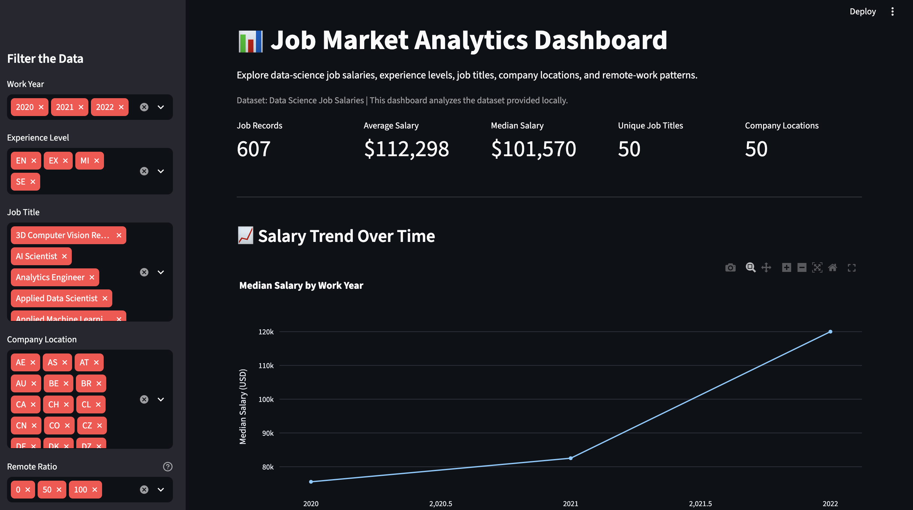

# Job Market Analytics Dashboard

An interactive dashboard for exploring data-science job salary records,
experience levels, job titles, company locations, and remote-work patterns.

## Project Overview

## Dashboard Preview


This project uses Python, Pandas, SQLite, Plotly, and Streamlit to analyze
a job-salary dataset and present the results through interactive charts
and filters.

## Features

- Filter by work year, experience level, job title, company location,
  and remote-work ratio
- View average and median salary metrics
- Analyze salary distributions
- Explore job-title and company-location records
- Compare remote-work arrangements
- View a SQL summary by experience level
- Download filtered records as CSV

## Tech Stack

- Python
- Pandas
- SQLite
- Plotly
- Streamlit

## Dataset

Dataset: Data Science Job Salaries

Source:
https://www.kaggle.com/datasets/rushi1990/data-science-job-salaries

Download the CSV and place it at:

`data/ds_salaries.csv`

Check the dataset's license and attribution requirements before
redistributing the data.

## Setup

```bash
git clone <your-repository-url>
cd job-market-analytics-dashboard

python3 -m venv .venv
source .venv/bin/activate

pip install -r requirements.txt